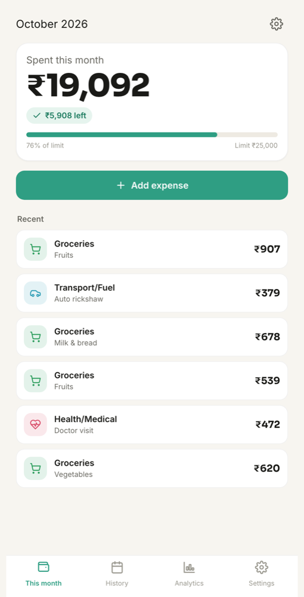
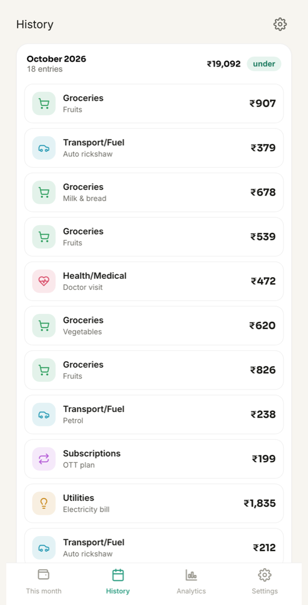
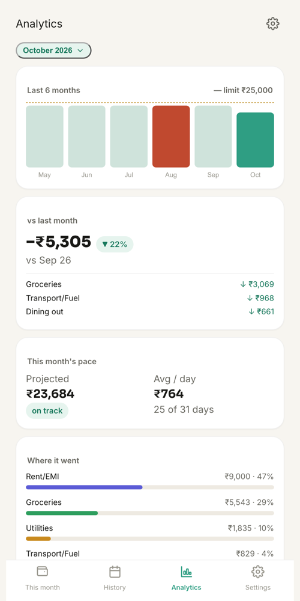

# Ghar Kharch

**Ghar Kharch** (Hindi for "household expenses") is a small, simple app for tracking what your home spends each month.

You log each expense as it happens. You set one monthly limit. The app always shows how much you have spent this month and how much is **left**, or, if you went past the limit, exactly how much you are **over by**.

It runs entirely on your own computer or phone. There is no account, no login, no server and no cloud: you download the code, open it, and your data stays on your device.

<p align="center">
  
  
  
</p>

<sub>Screenshots use made-up sample data.</sub>

---

## Contents

1. [What the app does](#1-what-the-app-does)
2. [What you need](#2-what-you-need)
3. [Get the code](#3-get-the-code)
4. [Run it](#4-run-it)
5. [Using the app](#5-using-the-app)
6. [Your data: where it lives and how to back it up](#6-your-data-where-it-lives-and-how-to-back-it-up)
7. [Using it on a phone](#7-using-it-on-a-phone)
8. [Troubleshooting](#8-troubleshooting)
9. [Customising it](#9-customising-it)
10. [How the code is organised](#10-how-the-code-is-organised)
11. [Running the tests](#11-running-the-tests)
12. [FAQ](#12-faq)

---

## 1. What the app does

The app has four screens, reached from the bar at the bottom.

| Screen | What you see and do |
|---|---|
| **This month** | The total spent so far this month, "₹X left" in green or "Over by ₹X" in red, a progress bar toward your limit, an **Add expense** button and your most recent entries. |
| **History** | Every month you have logged, newest first, each with its total and an "under" or "over" badge, followed by all of that month's entries. |
| **Analytics** | A chart of the last 6 months against your limit, this month compared with last month (and which categories rose or fell most), your daily average and projected month-end total, where the money went by category, automatic insights, your 5 biggest expenses and a summary of the year so far. Use the month button at the top to look at an earlier month. |
| **Settings** | Your monthly limit, your categories, and backup tools (export, import, clear). |

A few details:

- Amounts are in Indian Rupees with Indian digit grouping (₹1,20,000).
- A new month starts automatically on the 1st. You do not need to do anything.
- It ships with 12 everyday categories: Groceries, Utilities, Rent/EMI, Internet & Phone, Household, Health/Medical, Transport/Fuel, Dining out, Education, Maintenance, Subscriptions and Other.
- The default monthly limit is ₹25,000. Change it in Settings.

---

## 2. What you need

| You want to... | You need |
|---|---|
| Just use the app | A modern web browser: **Google Chrome**, **Microsoft Edge** or **Firefox** (recent versions). Nothing else. |
| Use it offline, or install it like an app (optional) | One of: **Python 3** (already on macOS and most Linux), or **Node.js 18+** |
| Run the automated tests (optional) | **Node.js 18 or newer** |

There is nothing to install for the app itself: no `npm install`, no build step and no libraries. It is plain HTML, CSS and JavaScript.

---

## 3. Get the code

**Option A: download a ZIP (no tools needed)**

1. At the top of this GitHub page, click the green **Code** button.
2. Click **Download ZIP**.
3. Unzip it. You get a folder called `ghar-kharch-main`. Put it somewhere permanent, such as your Documents folder (see the note in section 6 about why).

**Option B: clone with Git**

```bash
git clone https://github.com/devamparmar009/ghar-kharch.git
cd ghar-kharch
```

---

## 4. Run it

### Quickest way: open the file

Double-click **`index.html`** in the folder, or drag it into a browser window. The app opens straight away.

This is all most people need. Everything works, including saving your expenses. The only things you do not get this way are offline caching and "install as an app", because browsers only allow those on a web address (see the next option).

### Recommended way: run a tiny local server

A local server runs only on your own computer and is not reachable from the internet. It lets the browser treat the app as a proper web app, so it works fully offline and you can install it with its own icon.

Open a terminal **in the project folder** and run **one** of these:

```bash
python3 -m http.server 8000
```

```bash
npx serve -l 8000 .
```

(On Windows, if `python3` is not found, try `python -m http.server 8000` or `py -m http.server 8000`.)

Then open **http://localhost:8000** in your browser. Leave the terminal window open while you use the app; press `Ctrl + C` in it to stop the server.

To make it feel like a normal app, install it from the browser:

- **Chrome / Edge:** click the install icon at the right end of the address bar (or menu **⋮ → Cast, save, and share → Install page as app**).
- It then opens in its own window from your Start menu, Dock or desktop.

> **Important:** use the same address every time (for example always `http://localhost:8000`). Each address keeps its own separate data, so `localhost:8000` and `localhost:5000` would look like two different, empty apps. See [Troubleshooting](#8-troubleshooting).

---

## 5. Using the app

### Add an expense

1. On **This month**, tap **Add expense**.
2. Type the amount on the on-screen keypad (`⌫` deletes the last digit).
3. Tap a category.
4. Optionally add a short note, such as "vegetables" or "electricity bill".
5. The date is today. Tap it to pick an earlier date if you are logging something from the past; it is counted in that date's month.
6. Tap **Save**. On a small screen you may need to scroll down a little to reach it.

### Edit or delete an expense

Tap any entry on **This month** or **History**. The same sheet opens with the details filled in. Change anything and tap **Save changes**, or tap **Delete** (you are asked to confirm).

### Set your monthly limit

**Settings → Monthly limit**, type the amount, tap **Save**. The same limit applies to every month. Set it to `0` if you only want to see totals without a limit.

### Manage categories

- **Add:** in **Settings → Categories**, tap **+**, type a name, pick an icon and a colour, and tap **Save**.
- **Delete:** tap the bin icon next to a category. Expenses that used it are kept; on This month and History they appear under a grey "Other" label.
- Existing categories cannot be renamed. Add a new one and delete the old one instead.

### Read your analytics

- **Last 6 months:** one bar per month. The dashed line is your limit; months over it are red.
- **vs last month:** how much more or less you spent than last month, and the categories that changed most.
- **This month's pace:** your average spend per day so far, and what the month will total if you keep going at that rate. Early in the month this is only a rough guess.
- **Where it went:** each category's share of the month.
- **Insights, Biggest expenses, Year so far:** quick summaries worked out from what you logged.

With little history (your first month or two) some of these say "Not enough history yet". That fills in as you use the app.

---

## 6. Your data: where it lives and how to back it up

**Where it is stored.** Everything you enter is saved in your browser's local storage on your own device, under the key `ghar-kharch-data`. It is never sent anywhere. The app makes only one kind of network request: loading its two fonts (Inter and Sora) from Google Fonts when you are online. Without internet it falls back to a system font.

**What can delete it.** Because the data lives inside the browser, it is removed if you:

- clear your browser's history, cookies or site data for this app,
- uninstall the browser, or
- switch to a different browser, profile or address (the old data is still there, just not visible from the new place).

If you opened the app as a file, moving or renaming the folder can also make it look empty in some browsers. Keep the folder in one place.

**Back up regularly.** Go to **Settings → Export backup (JSON)**. A file named like `ghar-kharch-backup-2026-10-25.json` downloads. Keep it somewhere safe, such as a cloud drive or email it to yourself. Once a month is a good habit.

**Restore or move to another device or browser.** Open the app in the new place, go to **Settings → Import backup** and pick your backup file.

> Import **replaces** everything currently in the app with the contents of the backup file. Export first if the app already has data you want to keep.

**Start over.** **Settings → Clear all data** erases every expense and resets settings on this device. It cannot be undone, so export a backup first.

**What a backup file looks like.** It is plain, readable JSON, so you can also open it in any text editor or convert it for a spreadsheet:

```json
{
  "version": 1,
  "monthlyLimit": 25000,
  "currency": "INR",
  "categories": [
    { "id": "groceries", "label": "Groceries", "icon": "shopping-cart", "color": "#2E9E5E" }
  ],
  "expenses": [
    {
      "id": "a1b2c3",
      "amount": 1250,
      "category": "groceries",
      "note": "vegetables",
      "date": "2026-10-24",
      "createdAt": 1792800000000,
      "updatedAt": 1792800000000
    }
  ]
}
```

---

## 7. Using it on a phone

The app is designed for phones, but it has no hosted version: you run your own copy. Two ways:

**A. From your computer, over home Wi-Fi (quick)**

1. Start the local server on your computer and bind it to your network:
   ```bash
   python3 -m http.server 8000 --bind 0.0.0.0
   ```
2. Find your computer's local IP address (macOS: **System Settings → Wi-Fi → Details**; Windows: run `ipconfig` and look for "IPv4 Address"). It looks like `192.168.1.23`.
3. On your phone, connected to the same Wi-Fi, open `http://192.168.1.23:8000`.

Data saved this way is stored on the **phone**, not on the computer. The computer must be on and the server running each time you open it, and offline mode and "install as app" do not work over a plain `http://` network address.

**B. Host your own private copy (permanent)**

If you want it on your phone every day, put the folder on any static web host under your own account (for example GitHub Pages on your own fork, Netlify or Cloudflare Pages). Over `https` the app works offline and can be added to the home screen (**Chrome:** menu **⋮ → Add to Home screen**; **Safari:** **Share → Add to Home Screen**). Your expenses still stay on the phone; the host only serves the app's files.

---

## 8. Troubleshooting

| Problem | Cause and fix |
|---|---|
| **My expenses disappeared.** | Almost always you are on a different address, browser or profile than before (for example `localhost:8000` instead of `localhost:5000`, or the file instead of the server). Go back to the exact place you used before. If browser data was cleared, import your latest backup. |
| **Fonts look different.** | You are offline, so the app uses a system font. Nothing is wrong. |
| **No "install" option in the browser.** | Install only works on `http://localhost` or an `https://` address, not when opening `index.html` as a file, and not in Firefox desktop. Use Chrome or Edge with the local server. |
| **`python3: command not found`** | On Windows use `python` or `py`. Or use `npx serve -l 8000 .` if Node.js is installed. |
| **Port 8000 is already in use.** | Pick another number, such as `python3 -m http.server 8080`, then always use that same address. |
| **I changed the code but the app shows the old version.** | When served, the app caches its files for offline use. Bump the version in `sw.js` (`ghar-kharch-v2` → `ghar-kharch-v3`) and reload twice, or in Chrome DevTools go to **Application → Service workers → Unregister**. |
| **Import says "Invalid backup format".** | The file is not a Ghar Kharch backup, or was edited and is no longer valid JSON. It must contain `expenses` and `categories` lists. |

---

## 9. Customising it

You need nothing more than a text editor.

| To change... | Edit |
|---|---|
| The default categories (for brand-new installs) | `DEFAULT_CATEGORIES` in `js/storage.js` |
| The default monthly limit (for brand-new installs) | `DEFAULT_LIMIT` in `js/storage.js` |
| Colours, fonts, spacing, corner radius | CSS variables in `css/tokens.css` (the full design system is described in `design.md`) |
| Category icons | `js/icons.js` (inline SVG paths); add a name to `CATEGORY_ICON_CHOICES` to offer it in Settings |
| Currency formatting | `formatCurrency` in `js/format.js` |
| App name and home-screen icon | `manifest.json` and the images in `assets/` |

Defaults only apply the first time the app runs on a device. To see changes to defaults, use **Settings → Clear all data** (after exporting a backup) or open the app at a new address.

---

## 10. How the code is organised

```
ghar-kharch/
├── index.html          This month screen (+ the Add expense sheet)
├── history.html        History screen
├── analytics.html      Analytics screen
├── settings.html       Settings screen
├── manifest.json       App name, icons and colours for installing
├── sw.js               Service worker: caches the files so the app works offline
├── css/
│   ├── tokens.css      Design tokens (colours, type, spacing)
│   ├── main.css        Layout and page structure
│   ├── components.css  Cards, buttons, chips, sheet, keypad
│   └── charts.css      Chart styles
├── js/
│   ├── storage.js      Data layer: load/save, expenses, categories, export/import
│   ├── analytics.js    Pure calculations behind the Analytics screen
│   ├── format.js       ₹ formatting, dates and month helpers
│   ├── app.js          Shared UI helpers: toast messages, count-up, nav, confirm dialog
│   ├── home.js         This month screen
│   ├── addexpense.js   Add / edit expense sheet and keypad
│   ├── history.js      History screen
│   ├── analytics-view.js  Analytics screen
│   ├── charts.js       Small SVG chart renderer (no chart library)
│   ├── settings.js     Settings screen
│   └── icons.js        Inline SVG icon set
├── assets/             App icons
├── tests/              Unit tests (Node's built-in test runner)
├── docs/screenshots/   Images used in this README
└── design.md           Design system notes
```

**How a page works.** Each HTML page loads the shared scripts (`format.js`, `icons.js`, `storage.js`, `analytics.js`, `app.js`) and then its own screen script. The screen script calls `bootstrap(render)`, which draws the bottom navigation and then the screen. Every change goes through `storage.js`, which keeps one JavaScript object in memory and writes it back to `localStorage` as JSON after each change.

**Design choices.**

- **No framework, no build, no dependencies,** so anyone can read, run and change it with only a browser and a text editor.
- **Local-only data** (no accounts or sync), so there is nothing to sign up for and nothing to leak.
- **Calculations kept separate from the screens.** `analytics.js` and `format.js` are pure functions with no browser code, which is why they can be unit-tested in Node.
- **Light, calm interface** with large numbers and big tap targets, meant for daily use by anyone in the family. Animations respect the "reduce motion" system setting.

---

## 11. Running the tests

The tests use Node's built-in test runner, so there is nothing to install. From the project folder:

```bash
node --test tests/*.test.js
```

They cover:

- `format.test.js`: rupee formatting with Indian grouping (including negatives), month keys and labels, leap-year February, and HTML escaping of user text
- `storage.test.js`: adding, editing and deleting expenses, the monthly limit, import/merge, and that data is stored as plain JSON under its own key
- `analytics.test.js`: monthly totals, the 6-month trend, category breakdown, month-over-month change and top movers, pace and projection against the limit, biggest expenses, yearly summary, and insights when there is little history

---

## 12. FAQ

**Is it free?** Yes. Download it and use it.

**Can two people share the same data?** Not automatically: each device keeps its own data. You can move data between devices with Export and Import (import replaces what is there).

**Does it work without internet?** Yes. Opened from a file, everything except the web fonts works offline. Run through a local server or your own `https` host, the app caches itself and works fully offline after the first visit.

**Is my data private?** Yes. It never leaves your device, and there is no analytics, tracking or advertising code.

**Can I use another currency?** Rupees are built in. A developer can change `formatCurrency` in `js/format.js`.

**Can I export to Excel?** Export gives a JSON file. Most spreadsheet tools, or a short script, can convert it; each item in `expenses` becomes a row.
